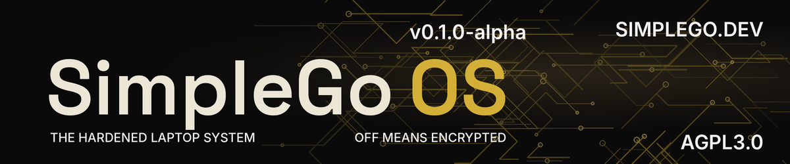

<p align="center">
  
</p>

<h1 align="center">SimpleGo OS</h1>

<p align="center">
  <strong>The hardened laptop system of SimpleGo. Off means encrypted.</strong><br>
  A focused desktop for private communication: everything over Tor, no standby, no screen saver, nothing left in memory when the lid closes.
</p>

<p align="center">
  <a href="LICENSE"></a>
  <a href="#status"></a>
  <a href="#getting-started"></a>
  <a href="https://simplego.dev"></a>
</p>

---

SimpleGo OS turns a standard laptop into a closed, private workstation for the SimpleGo system: the SimpleGo Messenger on the desktop, our own onion-only SimpleX relays, and a hardened base where the disk is encrypted whenever the laptop is not running.

It is built around one rule that the whole system follows: a laptop that is off is encrypted, and a laptop that is running is the only state in which anything can be read. So there is no standby, no hibernate and no screen saver that only looks like "off". Closing the lid, pressing the power button or leaving the laptop unused powers it off.

---

## Protection

| Layer | What SimpleGo OS does | What it protects against |
|:------|:----------------------|:-------------------------|
| **Disk** | Full disk encryption (LUKS2, AES-XTS 512 bit, Argon2id) | A lost or seized laptop that is off. |
| **Power** | No standby, no hibernate, no screen saver. Lid, power key and idle power off. | Cold boot and memory attacks on a sleeping or "locked" laptop. |
| **Instant off** | The disk key is wiped from kernel memory (`cryptsetup luksSuspend`) before the power is cut; a power off that does not complete within 15 seconds ends in an immediate restart to the passphrase prompt. | Hardware that hangs on power off with the key still in RAM. |
| **Lock screen** | Optional and off by default; switched on only after a warning that a lock encrypts nothing. | Users mistaking a locked laptop for a protected one. |
| **Sensors** | Camera driver not loaded at boot, microphone muted at login, Bluetooth blocked at boot. Each can be switched on until the next start. | Silent recording and radio exposure. |
| **Network** | All traffic through Tor; a kill switch blocks everything else, even when Tor is not running. Clock set over Tor. | Leaks of the real address, traffic outside Tor. |

---

## What is in this repository

| Folder | Content |
|:-------|:--------|
| [`shell/`](shell/) | The SimpleGo OS shell in Rust and GTK4: top bar, sidebar, Home menu, and the apps Settings, Clean Drop and Server. |
| [`os/`](os/) | Laptop configuration as files in their target paths: power and lock handling, the settings backends, logind and sleep policy, sensor defaults. |
| [`server/`](server/) | Tooling for our onion-only SimpleX relays (being moved here from the lab, see the folder's README). |
| [`docs/`](docs/) | Architecture, security model, development, legal notices, release notes. |

---

## Getting Started

SimpleGo OS is in alpha. It is installed by IT & MORE Systems on delivered laptops; an installable image is being built in the separate repository `simplego-distribution`.

### Build the shell and apps from source

On Debian 13 (trixie), x86_64:

```bash
sudo apt install rustc cargo pkg-config libgtk-4-dev libgtk4-layer-shell-dev
cd shell
cargo build --release
```

The binaries are `sentinel-shell`, `settings`, `cleandrop` and `serverapp` in `shell/target/release/`. Without `gtk4-layer-shell` (for previews on another desktop) build with `--no-default-features`.

### Install the laptop configuration

The files in [`os/rootfs/`](os/rootfs/) go to the same paths on the laptop. See [`os/README.md`](os/README.md) for the order and the commands.

---

## Status

Version `0.1.0-alpha`. Running daily on the reference laptop. Settings stage 1 is complete (seven categories, every control with a working backend); stage 2 (USB device policy, clipboard clearing, Tor bridges, change disk passphrase, backup and restore assistant) is in design.

---

## Documentation

| Resource | Link |
|:---------|:-----|
| Architecture | [docs/ARCHITECTURE.md](docs/ARCHITECTURE.md) |
| Security model | [docs/SECURITY_MODEL.md](docs/SECURITY_MODEL.md) |
| Development and build | [docs/DEVELOPMENT.md](docs/DEVELOPMENT.md) |
| Release notes | [docs/release-info/](docs/release-info/) |
| Contributing guidelines | [CONTRIBUTING.md](CONTRIBUTING.md) |
| Legal notices | [docs/LEGAL.md](docs/LEGAL.md), [docs/TRADEMARK.md](docs/TRADEMARK.md), [docs/DISCLAIMER.md](docs/DISCLAIMER.md) |

Security vulnerabilities should be reported privately via GitHub's [vulnerability reporting](https://github.com/saschadaemgen/simplego-os/security) feature.

---

## License

| Component | License |
|:----------|:--------|
| Software | [AGPL-3.0](LICENSE) |

## Acknowledgments

[Debian](https://www.debian.org/) (base system) - [GTK](https://www.gtk.org/) and [gtk-rs](https://gtk-rs.org/) (user interface) - [labwc](https://labwc.github.io/) (Wayland compositor) - [Tor](https://www.torproject.org/) (anonymous networking) - [SimpleX Chat](https://simplex.chat/) (messaging protocol and relays) - [cryptsetup](https://gitlab.com/cryptsetup/cryptsetup) (LUKS2 disk encryption) - [swayidle](https://github.com/swaywm/swayidle), [wlr-randr](https://sr.ht/~emersion/wlr-randr/), [wlsunset](https://sr.ht/~kennylevinsen/wlsunset/), [brightnessctl](https://github.com/Hummer12007/brightnessctl), [WirePlumber](https://pipewire.pages.freedesktop.org/wireplumber/)

---

<p align="center">
  <i>SimpleGo OS is an independent open-source project by IT and More Systems, Recklinghausen, Germany.</i><br>
  <i>SimpleGo uses the open-source SimpleX Messaging Protocol (AGPL-3.0) for interoperable message delivery and Tor for anonymous networking.</i><br>
  <i>It is not affiliated with or endorsed by any third party. See <a href="docs/DISCLAIMER.md">docs/DISCLAIMER.md</a> for full legal notices.</i>
</p>

<p align="center">
  <strong>SimpleGo OS - Off means encrypted.</strong>
</p>
